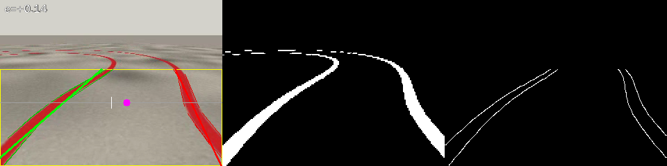

# deepthinkcar

라즈베리파이 4와 카메라 한 대로 바닥의 **빨간 테이프 차선**을 따라 달리는 자율주행 RC카입니다.
OpenCV 차선 인식과 딥러닝(PilotNet 구조 CNN) 두 방식으로 주행하고, 웹 브라우저에서 조종·튜닝·녹화를 합니다.



*시뮬레이터 화면의 차선 인식. 왼쪽부터 결과, 빨간색 마스크, 에지*

## 주요 기능
- **세 가지 주행 모드**: 수동 / OpenCV(차선 인식 + PID) / AI(CNN 조향 예측)
- **급커브 대응**: 꺾인 모서리와 U턴을 미리 감지해 감속하고 더 크게 조향
- **난이도 기반 속도**: 차선을 유지하기 어려우면 감속, 쉬워지면 서서히 복귀
- **웹 대시보드**: 실시간 영상, 조종, 비상정지, HSV·PID·속도 튜닝
- **자동 녹화 → 재학습**: 주행 사진을 모아 파인튜닝하고 이전 모델과 비교
- **하드웨어 없이 실행**: mock 모드와 트랙 시뮬레이터

## 현재 상태
| 항목 | 상태 |
|---|---|
| 처리 속도 | 주행 로그 기준 20 FPS (목표 15 이상) |
| 완만한 커브, 일부 급커브 | 실차 주행 확인 |
| U턴 | 한 번 돌아 나왔으나 안쪽 차선을 밟음. 반복 통과는 미확인 |
| 급커브 일부 | 이탈이 있어 개선 중 |
| 5바퀴 연속 무이탈 | **실차 미달성** (시뮬레이터의 OpenCV 모드에서는 달성) |

자세한 과정은 [개발 기록](docs/DEVELOPMENT_LOG.md), 내부 구조는 [구조 설명](docs/ARCHITECTURE.md)에 있습니다.

## 하드웨어
[deepThinkCar-mini 키트](https://github.com/JD-edu/deepThinkCar_mini)를 기반으로 합니다.

| 부품 | 연결 |
|---|---|
| Raspberry Pi 4 (4GB), Raspberry Pi OS 64-bit | |
| Pi Camera (OV5647) | CSI 리본 케이블 |
| DC 기어드 모터 2개 + L9110 | 오른쪽 HAT M1 (PWM 19 / DIR 13), 왼쪽 HAT M2 (PWM 12 / DIR 16), BCM 번호 |
| 조향 서보 | HAT JP1:S1 (PCA9685 0번 채널), 주황색 선이 S, 90° = 직진 |
| 18650 배터리 2개 | HAT BAT, 전원 스위치 |

HAT은 GPIO 40핀에 어긋남 없이 꽂아야 합니다.

## 설치
```bash
sudo apt install python3-picamera2            # 라즈베리파이에서만
git clone https://github.com/pth6254/deepthinkcar.git
cd deepthinkcar
python3 -m venv --system-site-packages venv   # picamera2 를 쓰기 위해 시스템 패키지 허용
source venv/bin/activate
pip install -r requirements.txt
```
I2C는 `sudo raspi-config` → Interface Options에서 켭니다.

### AI 모델 준비
학습된 `.tflite` 파일은 저장소에 없습니다. 기본 모델을 한 번 변환하세요.
```bash
python training/train.py --convert-only       # models/lane_kit.h5 → models/lane_kit.tflite
```
그리고 `config.yaml`의 `cnn.model`을 `models/lane_kit.tflite`로 바꿉니다. OpenCV 모드는 모델 없이 동작합니다.

## 하드웨어 없이 먼저 해 보기
```bash
python main.py --sim --input web                        # 시뮬레이터를 브라우저로 조종
python main.py --sim --mock --mode opencv --laps 5      # 시뮬레이터 자율주행 5바퀴
python autopilot/lane_detect.py assets/sample.mp4 --out overlay.mp4 --debug
python tests/test_safety.py                             # 안전 동작 테스트
```

## 실차 사용 순서
1. **점검** (바퀴를 띄우고): `python hardware/test_all.py`
2. **조향 보정**: `python hardware/calibrate.py`
3. **실행**: `python main.py` → 로그의 주소(`http://<라즈베리파이 IP>:8080`)를 같은 Wi-Fi의 브라우저에서 열기
4. **차선 색 맞추기**: "HSV 마스크" 화면에서 테이프만 하얗게 보이도록 조정하고 저장
5. **주행**: 바퀴를 띄워 조향 방향을 확인한 뒤 바닥에서 짧게 시작

| 조작 | PC | 휴대폰 |
|---|---|---|
| 전진·후진 / 조향 | W·S / A·D | 가상 조이스틱 |
| 모드 (수동 / OpenCV / AI) | 1 / 2 / 3 | 버튼 |
| **비상정지** | **Space** | 빨간 버튼 |
| 녹화 | R | 버튼 |

SSH 키보드나 게임패드는 `--input keyboard`, `--input gamepad`로 씁니다.

## AI 추가 학습
차가 움직이면 모든 모드에서 자동으로 `data/`에 녹화됩니다.
```bash
python training/train.py --test 녹화폴더이름   # 이 녹화는 시험용으로만 사용
python training/make_video.py                  # 최신 녹화를 동영상으로
```
결과는 `models/lane_날짜_시간.tflite`로 저장되고 현재 모델과 비교합니다. 좋아졌으면 `cnn.model`을 바꾼 뒤 실제 주행으로 확인하세요. 차선을 벗어난 녹화는 학습 전에 빼는 것이 좋습니다.

## 안전
- 비상정지: 즉시 모터 정지, 조향 중립
- 자율주행 중 정지 후 수동 전환: 차선 0.5초 미검출, 조작 장치 1초 끊김, 카메라 끊김
- 종료(Ctrl+C, 예외, SSH 끊김) 시 모터 정지, 명령이 0.5초 없으면 워치독 정지

> **주의**
> - 급커브 보조가 작동하면 차선 미검출 정지가 최대 0.75초 늦어질 수 있습니다.
> - 이탈한 뒤 다른 빨간 물체나 테이프를 차선으로 볼 수 있습니다. 바로 비상정지하세요.
> - 웹 대시보드는 기본적으로 **비밀번호가 없어** 같은 네트워크의 누구나 조종할 수 있습니다. 공용 Wi-Fi에서는 `config.yaml`의 `web.token`을 설정하세요. 인터넷에 공개하지 마세요.

## 폴더 구조
```
main.py, config.yaml   실행 진입점, 모든 설정
autopilot/             차선 인식, 제어, 급커브, 난이도, AI 추론
hardware/              카메라, 모터·서보, 보정, 점검
inputs/                키보드, 게임패드
web/                   웹 대시보드
training/              녹화, 학습, 동영상 변환
sim/                   트랙 시뮬레이터
tests/                 안전 동작 테스트
models/                기본 모델 (lane_kit.h5)
docs/                  구조 설명, 개발 기록
```

## 출처
- 기본 모델 `models/lane_kit.h5`와 하드웨어 구성: [JD-edu/deepThinkCar_mini](https://github.com/JD-edu/deepThinkCar_mini)
- 모델 구조: Bojarski et al., [End to End Learning for Self-Driving Cars](https://arxiv.org/abs/1604.07316) (2016)

이 저장소에는 아직 라이선스가 지정되어 있지 않습니다.
